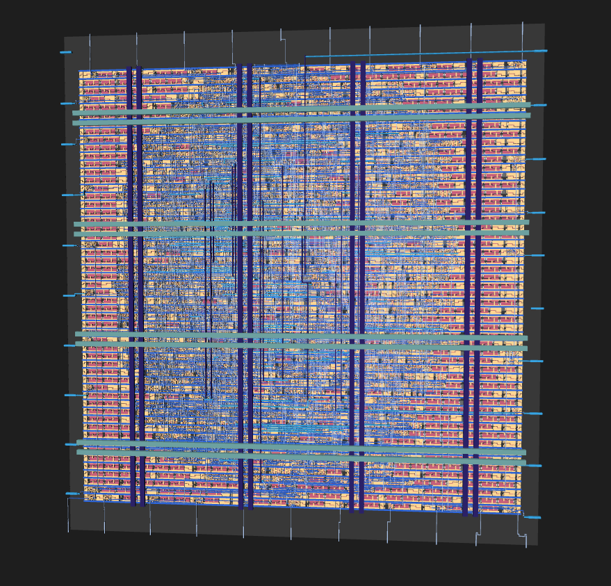
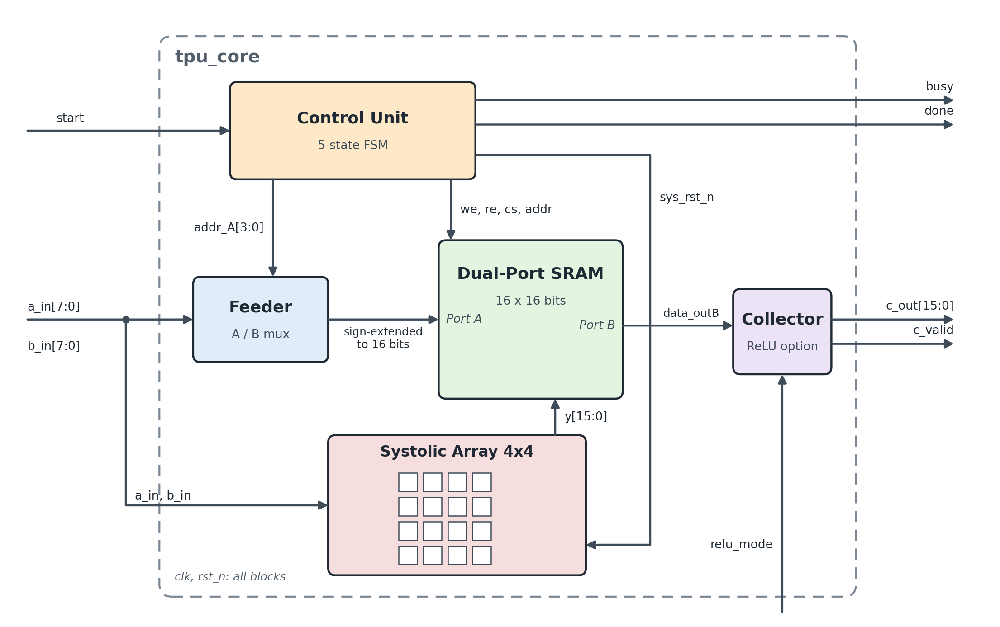
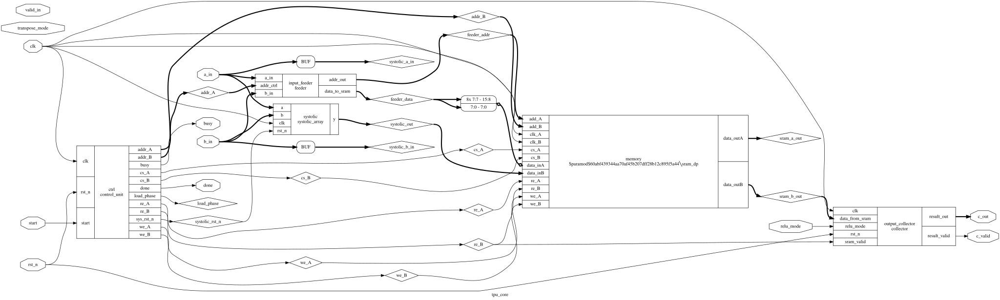

# 4x4 Systolic Array TPU: RTL to GDSII Implementation


<p align="center">
  
  <br><em>Final tpu_core layout, Sky130 PDK (OpenLane flow). Die size is about 159 x 170 um.</em>
</p>


## 1. Introduction

This project takes a small TPU-style matrix engine from RTL to a finished GDSII layout. The core is a 4x4 grid of multiply-accumulate cells that works alongside a dual-port SRAM and is sequenced by a state machine. It was synthesized with Yosys and then pushed through the OpenLane/OpenROAD flow on the SkyWater SKY130A PDK.

The point of the project was to go through the whole ASIC pipeline once on something with real structure: RTL, simulation, synthesis, floorplan, placement, clock tree, routing and signoff. The design is small on purpose so every step runs in a couple of minutes.

The overall idea was inspired by [TPUv2](https://github.com/WilliamZhang20/TPUv2) by WilliamZhang20, a mini TPU project. This design is a separate implementation with its own RTL and its own physical design run.

If systolic arrays are new to you, the two original papers by H. T. Kung are in the `doc` folder, and the video below was the starting point for this project:

- [Kung and Leiserson, 1978 (CMU report)](doc/1978-cmu-cs-report-kung-leiserson.pdf)
- [Kung, "Why Systolic Architectures?", 1982](doc/1982-kung-why-systolic-architecture.pdf)
- [Onur Mutlu: Systolic Architecture Lecture](https://www.youtube.com/watch?v=jll-Xc9Gpnw)


## 2. High-Level Architecture

Two signed 8-bit streams (`a_in`, `b_in`) go in, and a signed 16-bit stream (`c_out`) comes out. The design has five blocks plus a top module that wires them together.

<p align="center">
  
  <br><em>Block diagram of tpu_core</em>
</p>

### Control Unit

A five-state FSM that sequences everything:
- IDLE, waiting for `start`
- LOAD_A, four cycles, writes SRAM addresses 0 to 3
- LOAD_B, four cycles, writes SRAM addresses 4 to 7
- COMPUTE, lets the array run
- READ, four cycles, reads results out of SRAM port B

It also drives `busy` and `done`, the SRAM enables and the array reset.

### Feeder

A small multiplexer. Bit 3 of the SRAM address decides whether `a_in` or `b_in` is written, so addresses 0 to 7 pick up A then B.

### Dual-Port SRAM

16 words of 16 bits with two independent ports, each with its own clock and enables. The memory map is A at addresses 0 to 3, B at 4 to 7 and results at 8 to 15.

### Systolic Array

Two 4-stage shift registers carry the A and B operands. Sixteen 16-bit accumulators each add the product of one A tap and one B tap every cycle. The top level takes its output from the bottom-right accumulator.

### Collector

Registers the SRAM port B data on its way out and optionally applies ReLU, which simply forces negative values to zero.


## 3. RTL Implementation

All RTL sources are under:
```
rtl/
├── module/
│   ├── control_unit.v
│   ├── feeder.v
│   ├── sram_dp.v
│   ├── systolic_array.v
│   ├── mac.v
│   └── collector.v
└── topmodule/
    └── tpu_core.v
```

`mac.v` is a standalone saturating MAC. The systolic array does its own multiply-accumulate inline, so `mac.v` is compiled but not instantiated. Module-by-module notes are in [rtl/readme.md](rtl/readme.md).


## 4. Functional Verification

Testbenches live under:
```
verif/functionalVerification/
├── modules/
│   ├── tb_systolic_array.v
│   ├── tb_sram_dp.v
│   └── tb_control_unit.v
└── topmodule/
    └── tb_tpu_core.v
```

Each testbench drives stimulus and dumps a VCD file that you open in GTKWave. Details and what to look at in each waveform are in [verif/readme.md](verif/readme.md).


## 5. Logic Synthesis (Yosys)

Scripts and outputs:
```
synth/
├── tpu_synth.ys
├── tpu_show.ys
├── tpu_synth.v
├── tpu_core.svg
└── tpu_core.dot
```

`tpu_synth.ys` produces a generic gate-level netlist. `tpu_show.ys` renders the block diagram below. This is separate from the synthesis that OpenLane runs for the physical flow, which targets the Sky130 standard cells. See [synth/readme.md](synth/readme.md).

<p align="center">
  
  <br><em>Block diagram of tpu_core extracted by Yosys</em>
</p>


## 6. Physical Design: OpenLane/OpenROAD

The physical flow used the `sky130_fd_sc_hd` standard cell library and the settings in [config.tcl](config.tcl):

- 10 ns clock (100 MHz)
- 40% target core utilization
- 0.65 placement density
- Timing-driven placement
- Synthesis strategy `DELAY 2`, max fanout 6

The flow ran start to finish in under two minutes and covers floorplanning, power grid, placement, clock tree synthesis, global and detailed routing, RC extraction, DRC, LVS and antenna checks. Reports from each stage are in `reports/`, and the extracted parasitics and timing files are in `routing/` and `signoff/`.

Final layout:
```
gds/tpu_core.gds
```

You can also [open the layout in your browser](https://gds-viewer.tinytapeout.com/?model=https://raw.githubusercontent.com/VLSI-Shubh/Tensor-Processing-Unit-TPU/main/gds/tpu_core.gds) using the Tiny Tapeout GDS viewer, which loads the GDS straight from this repository.


## 7. Key Results (from metrics.csv and reports)

### Target Clock
- 10 ns period (100 MHz)

### Timing (STA after RC extraction)
- Setup worst slack: 5.24 ns
- Hold worst slack: 0.35 ns
- WNS and TNS: 0.00
- Clock skew after CTS: about 0.03 ns

### Power (typical corner)
- Internal: 1.66e-03
- Switching: 1.06e-03
- Leakage: 5.98e-09
- Total: 2.72e-03 (units as printed by OpenSTA, see `reports/signoff/31-rcx_sta.power.rpt`)

### Area and Utilization
- Die: about 159 x 170 um (0.027 mm2)
- Core area: 21,688 um2
- Placement utilization: 41.94%
- Logic cells after synthesis: 841
- Total instances: 2,923 (including tap, decap and fill cells)

### Routing
- Wirelength: 24,749
- Vias: 6,478
- Detailed routing violations: 0

### Signoff
- DRC (Magic): 0 violations
- LVS: clean, 0 errors
- Antenna: 0 pin and 0 net violations
- Final GDSII: [gds/tpu_core.gds](gds/tpu_core.gds)

The summary of the three signoff checks is in `reports/manufacturability.rpt`.


## 8. Directory Structure
```
TPU/
├── asset/                images used in the READMEs
├── doc/                  papers and references
├── gds/                  final GDSII
├── reports/              OpenLane reports by stage
│   ├── synthesis/
│   ├── floorplan/
│   ├── placement/
│   ├── cts/
│   ├── routing/
│   ├── signoff/
│   ├── manufacturability.rpt
│   └── metrics.csv
├── routing/              routed DEF, netlists, SPEF, SDF, liberty (3 corners)
├── rtl/
│   ├── module/
│   └── topmodule/
├── signoff/              Magic, KLayout and SPICE views, LEF, final GDS
├── synth/                Yosys scripts and outputs
├── verif/
│   └── functionalVerification/
│       ├── modules/
│       └── topmodule/
├── Dockerfile
├── config.tcl
├── run_sim.sh
└── License.txt
```


## 9. Running Simulation and Synthesis

This runs the four testbenches and the Yosys synthesis. It does not run OpenLane. The simplest route is Docker, since the image already has Icarus Verilog, Yosys, Graphviz and GTKWave.

From the repository root, build the image once:
```bash
docker build -t tpu-design .
```

Then run everything:
```bash
# Linux, macOS, Git Bash
docker run --rm -v "$(pwd):/design" tpu-design bash run_sim.sh
```
```powershell
# Windows PowerShell
docker run --rm -v "${PWD}:/design" tpu-design bash run_sim.sh
```

You can also run `./run_sim.sh` directly if you have a recent `iverilog` (one that accepts `-g2012`) and `yosys` installed.

**Produces:**
```
verif/functionalVerification/modules/*.vcd
verif/functionalVerification/topmodule/tb_tpu_core.vcd
synth/tpu_synth.v      synthesized netlist
synth/tpu_core.svg     block diagram extracted by Yosys
```

Open any `.vcd` in GTKWave on your own machine.

`run_sim.sh` ends with the OpenLane commands that were used for the physical flow, printed as hints. They need a separate OpenLane and Sky130 PDK installation and are not run by the script.


## 10. License

Open for educational and personal use under the [MIT License](License.txt).


## References

- [TPUv2 by WilliamZhang20](https://github.com/WilliamZhang20/TPUv2), the project that inspired this design.
- H. T. Kung and C. E. Leiserson, [Systolic Arrays (for VLSI)](doc/1978-cmu-cs-report-kung-leiserson.pdf), Carnegie Mellon University, 1978.
- H. T. Kung, [Why Systolic Architectures?](doc/1982-kung-why-systolic-architecture.pdf), IEEE Computer, 15(1), 1982.
- [OpenLane](https://github.com/The-OpenROAD-Project/OpenLane)
- [SkyWater SKY130 PDK](https://skywater-pdk.readthedocs.io/)
- [Yosys](https://github.com/YosysHQ/yosys)
